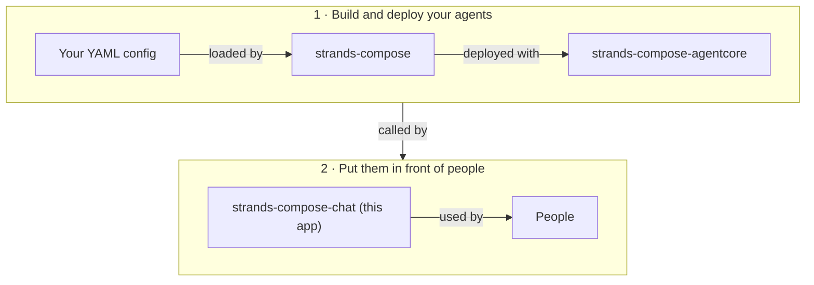

# Chapter 01 — What Is This?

## The Problem

You built an agent system with [strands-compose](https://github.com/strands-compose/sdk-python) and you run it on AgentCore. Now people need to use it. That means sign-in, saved conversations, file uploads, access rules and a bill you can explain. None of that is agent logic, and none of it is fun to build twice.

## The Answer

**strands-compose-chat** is a ready-to-run web application that sits in front of your agents. Install it from PyPI, point it at a database, register your agents in the admin panel, and people can chat.

The app talks to agents only through the strands-compose-agentcore client. Anything about agents or media formats stays consistent with the rest of the ecosystem.

## What You Get

| Feature | What it does |
|---------|--------------|
| Chat with streaming | Answers appear token by token. A Workflow panel shows agents, tool calls and handoffs live |
| Attachments | Images and documents sent with a message, within configurable size limits |
| History | Every conversation is saved and can be reopened, renamed or archived |
| Sign-in | Local username and password (Argon2id), plus OIDC single sign-on (Entra, Okta, Google, any OIDC provider) |
| API keys | Scripts call the agents and stream replies with `Authorization: Bearer sck_...` |
| Group access | An agent is visible only to members of a group it is assigned to. Closed by default |
| Budgets and pricing | Monthly budget per user, price per model, usage dashboards for users and admins |
| Admin panel | Register agents, manage users, groups, pricing and keys, read any transcript |

## Who It Is For

| You are | You use it to |
|---------|---------------|
| A developer with a finished agent | Give clients or colleagues a proper interface without building one |
| An organisation | Run an internal assistant behind company SSO, with cost visibility |
| An admin | Control who may use which agent, and how much they may spend |

## What It Is Not

- **Not an agent framework.** It does not define agents, models or tools. That is strands-compose.
- **Not an agent host.** It does not run your agents. They run on AgentCore Runtime, or as a local server you point to. Building and deploying them is covered in the [strands-compose-agentcore docs](https://github.com/strands-compose/bedrock-agentcore).
- **Not infrastructure as code.** These docs describe settings and steps for ECS Fargate. They do not ship Terraform, CDK or CloudFormation.

> **Tips & Tricks**
> Want a look before you install anything? The [live demo](https://strands-compose.github.io/chat/) runs the real UI on recorded fixtures, with no backend.

## Next

[Chapter 02 — Architecture](Chapter_02.md)
