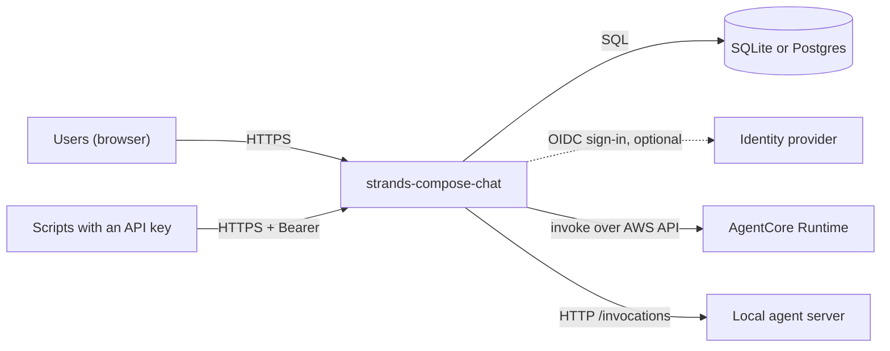
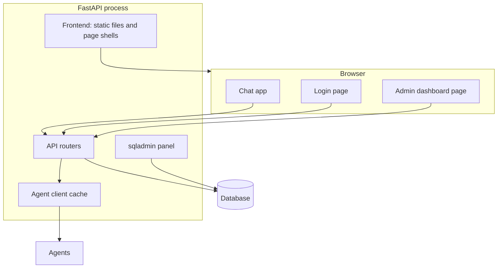
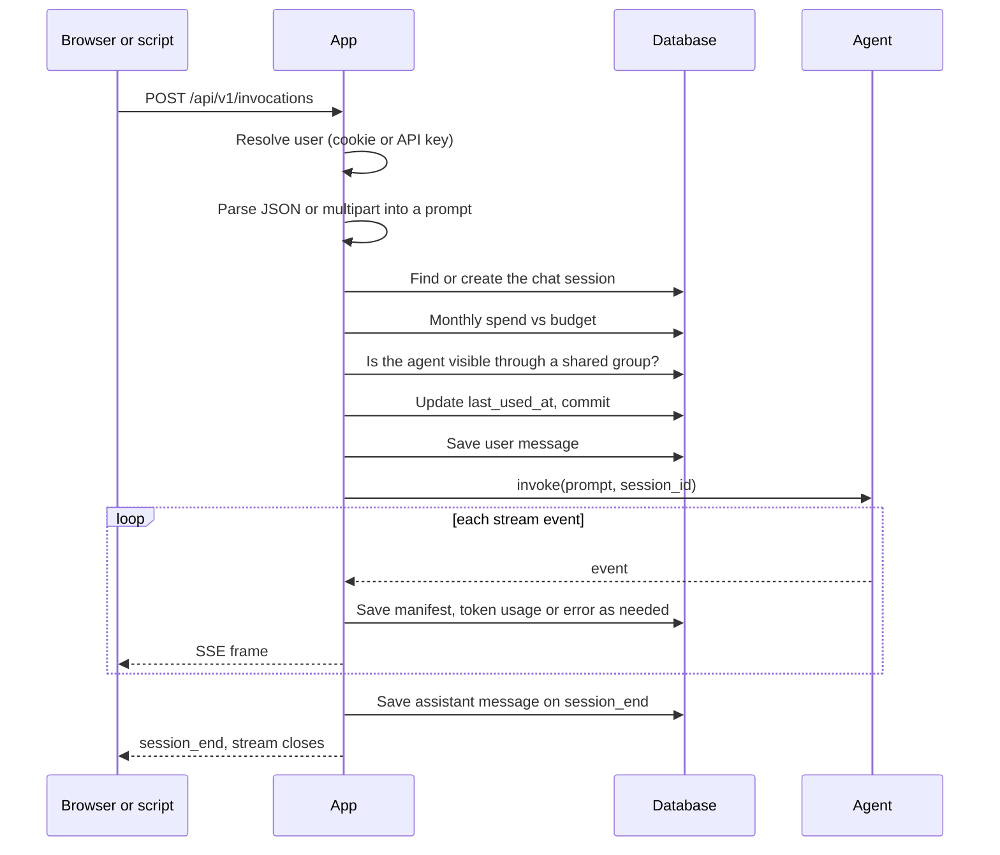
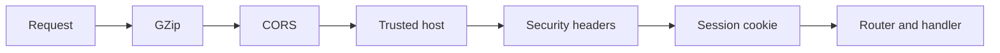

# Chapter 02 — Architecture

This chapter shows how the pieces fit, what happens during one chat turn, and what ends up in the database. It is a map. Settings live in [Chapter 09](Chapter_09.md) and endpoints in [Chapter 14](Chapter_14.md).

## The Big Picture

One Python process serves the API, the admin panel and the compiled web UI. There is no separate frontend server in production.

## The Parts

| Part | Job | Code |
|------|-----|------|
| Web UI | React app with three HTML entries: chat (`index.html`), login (`login.html`), admin dashboard (`admin/dashboard.html`) | `ui/` |
| Frontend serving | Serves compiled assets under `/static`, renders the chat and login shells, redirects to `/login` when signed out | [`frontend.py`](../src/strands_compose_chat/frontend.py) |
| API routers | Auth, agents, sessions, invocations, media, analytics | `auth/`, `agents/`, `sessions/`, `media/`, `analytics/` |
| Admin panel | sqladmin views for users, groups, agents, pricing, keys, plus transcript and dashboard pages | `admin/` |
| Agent client cache | One `AgentCoreClient` per runtime (ARN and region) for the life of the process. Local agents get a fresh client per request | [`agents/client.py`](../src/strands_compose_chat/agents/client.py) |
| Database | Async SQLAlchemy, Alembic migrations | `db/` |
| Assembly | `create_app()` wires handlers, middleware, routers, admin and frontend | [`app.py`](../src/strands_compose_chat/app.py) |

The admin dashboard is a React page shown inside the sqladmin home. The other admin screens are server-rendered sqladmin tables.

## One Chat Turn

Checks run in this order, and each failure is a Problem Details response before any stream starts:

1. Auth fails: `401`.
2. Body or file parts are invalid: `422`. Session belongs to another user or a different agent: `409`.
3. Budget used up: `402`.
4. Agent disabled, missing, or not shared with the user: `404`.

The session row is committed before the stream begins, so the database connection goes back to the pool while the agent works. During the stream, each save opens its own short transaction.

> **Tips & Tricks**
> The app mints the session id for a new conversation (`<uuid>_<USER-SUFFIX>`, for example `..._JANE-DOE-EXAMPLE-COM`) and returns it on `session_start`. The suffix makes sessions easy to spot in AgentCore logs.

## The Request Pipeline

| Layer | What it does |
|-------|--------------|
| GZip | Compresses responses over 1000 bytes. Event streams are skipped |
| CORS | Allows the origins in `CORS_ALLOWED_ORIGINS`, with credentials |
| Trusted host | Rejects hosts not in `TRUSTED_HOSTS`. `/health` and `/ready` are exempt so load balancer probes work |
| Security headers | Adds HSTS, CSP, `X-Frame-Options` and friends to every response |
| Session cookie | Signed cookie holding the user id. `Secure` outside `APP_ENV=dev`, `SameSite=Lax` |

## What Is Saved and When

| What | When | Notes |
|------|------|-------|
| Chat session row | Before the stream starts | Title is the first 64 characters of the first prompt |
| User message | Start of the stream, before the agent runs | Only if the text is not blank. Attachments are saved as metadata (name, size, type), not the file bytes |
| Manifest | On every `session_start` event | Overwrites the stored manifest and its timestamp |
| Token usage | On each `agent_complete` event with non-zero tokens | One row per agent per turn. Cost is priced at that moment. A model with no pricing row costs 0 |
| Assistant message | On `session_end`, if no error event came first | Text comes from the `session_end` payload. Empty text is skipped |
| Error bubble | On an `error` event, an upstream failure, or an unexpected exception | Saved as an assistant message with `is_success = false`. Duplicate errors in one turn are dropped |
| Rejected turn (`402`, `404`) | Before the stream | On an existing session, the prompt and the error text are saved so a reload shows what happened. A rejected first message leaves nothing behind |

Saving is best effort. Each save uses its own database session, logs a warning on failure and never interrupts the stream.

If the client disconnects mid-stream, the stream is closed, and for an AgentCore agent the app asks the runtime to stop the session. The user message and any token usage already recorded stay. The assistant message is written only when `session_end` arrives, so it is not saved for an abandoned turn.

## State: Per Process vs Shared

| Lives in | What |
|----------|------|
| Process memory | The agent client cache (connections only, nothing that can go stale), the OIDC provider registry, parsed settings |
| Database | Users, groups, agents, sessions, messages, token usage, pricing, API keys |
| The browser cookie | The signed session: which user is signed in |

Sessions are signed cookies, not server-side records. Any replica that shares the same `SESSION_SECRET_KEY` accepts the cookie, so you need no sticky sessions and no shared session store. Run as many replicas as you need behind one load balancer.

## Next

[Chapter 03 — Getting Started](Chapter_03.md)
