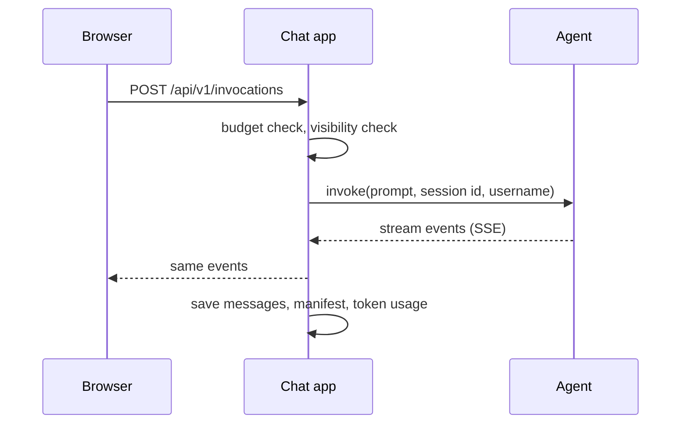

# Chapter 06 — Agents

An agent is a row in the **Agents** table that tells the chat where to send a prompt. The chat does not run agents. It calls them, streams the events back and records what happened. You build and deploy the agent itself with [strands-compose-agentcore](https://github.com/strands-compose/bedrock-agentcore).

## Two Kinds

| Kind | Where it runs | You provide | Use it for |
|---|---|---|---|
| **Agentcore Runtime** (`agentcore_runtime`) | AWS Bedrock AgentCore Runtime | Runtime ARN and region | Production |
| **Local** (`local`) | Any HTTP server that speaks `/invocations` | Endpoint URL | Development, `sca dev` |

For a local agent you can paste either the base URL (`http://localhost:8080`) or the full `.../invocations` URL. The chat strips the suffix and adds it back.

## The Admin Form


| Field | Required | What it does |
|---|---|---|
| **Name** | yes | Shown in the agent picker, in the dashboard and in the Profile tab. Must be unique |
| **Description** | yes | Markdown shown in the panel next to the welcome screen and in Profile. Newlines are kept |
| **Access Groups** | no, but see below | Groups whose members may use the agent |
| **Enabled** | default on | Off hides the agent from everyone and blocks new turns |
| **Multimodal** | default off | On enables the **+** attach button for this agent |
| **Agent Kind** | yes | `Agentcore Runtime` or `Local` |
| **Agent Runtime ARN** | runtime only | For example `arn:aws:bedrock-agentcore:eu-west-1:123456789012:runtime/my_agent-AbC123` |
| **Region** | runtime only | Region of the runtime, for example `eu-west-1` |
| **Endpoint URL** | local only | Base URL of the server |
| **Suggested Questions** | no | One per line. Shown as chips on the welcome screen |

Fill only the fields that belong to the chosen kind. The database rejects a runtime agent with an endpoint URL, and a local agent with an ARN or region.

Checks on save:

- A runtime agent needs both ARN and region. The ARN format is **not** validated, so a typo shows up on the first chat as an error bubble.
- A local agent needs an endpoint URL. With `APP_ENV=prod` it must be `https://`. In dev, `http://` is allowed only for `localhost`, `127.0.0.1` and `*.local` hosts.

> **Watch out:** an agent with no Access Groups is closed to everybody, including superusers. Add a group before you test ([Chapter 08](Chapter_08.md#group-based-visibility)).

**Delete** on an agent is a soft delete: it sets *Enabled* to off. Existing chats keep their link. If a user opens an old chat of a disabled agent and sends a message, the turn is refused with *Agent ... not available* and that failure is saved in the chat.

A user's picker lists at most 50 agents, ordered by id. The chat does not paginate that call.

## How the Chat Calls an Agent



- **Runtime agents** use `AgentCoreClient` from `strands-compose-agentcore`, which calls the AWS `InvokeAgentRuntime` API through boto3. The chat keeps **one client per runtime** (ARN plus region) for the life of the process and shares it between users. Changing the ARN or region in the admin builds a new client on the next call.
- **Local agents** get a fresh HTTP client per turn (5 s connect timeout, 300 s read timeout).
- The AgentCore session id looks like `<uuid>_<EMAIL-IN-CAPS>`, so you can find a person's sessions in AgentCore logs. The agent receives the chat username as its `user_id`.
- If the browser disconnects mid-stream (tab closed, **Stop**), the chat asks AgentCore to stop that runtime session. A failure there is logged and ignored.

## Permissions on AWS

The AWS identity of the chat process needs two actions:

| Action | Used for |
|---|---|
| `bedrock-agentcore:InvokeAgentRuntime` | Every turn. Without it the user sees *The agent service is currently unavailable* and the log shows an access denied error |
| `bedrock-agentcore:StopRuntimeSession` | Stopping a runtime when a user aborts. Optional, best effort |

AWS checks `InvokeAgentRuntime` against both the runtime and the endpoint being called. The chat passes no qualifier, so that is the `DEFAULT` endpoint. Allow the runtime ARN and everything under it:

```json
{
  "Effect": "Allow",
  "Action": ["bedrock-agentcore:InvokeAgentRuntime", "bedrock-agentcore:StopRuntimeSession"],
  "Resource": [
    "arn:aws:bedrock-agentcore:eu-west-1:123456789012:runtime/my_agent-AbC123",
    "arn:aws:bedrock-agentcore:eu-west-1:123456789012:runtime/my_agent-AbC123/*"
  ]
}
```

The username travels inside the request body, not as a runtime user header, so the `...ForUser` actions are not needed. Credentials come from the standard boto3 chain, which on ECS is the task role ([Chapter 12](Chapter_12.md)). See [Resource-based policies](https://docs.aws.amazon.com/bedrock-agentcore/latest/devguide/resource-based-policies.html) for how runtime and endpoint checks combine.

## The Manifest

At the start of every turn the agent sends a `session_start` event with a **manifest**: the agents, models and tools that make up the app. The chat stores it on the chat session (`manifest` and `manifest_captured_at`) and overwrites it each turn. You can read it as JSON on the session's detail page in **Chat Sessions**.

It also fills a gap in cost tracking: if an `agent_complete` event does not name its model, the chat looks the model up in the manifest ([Chapter 08](Chapter_08.md#pricing)).

## Next

[Chapter 07 — Authentication](Chapter_07.md)
