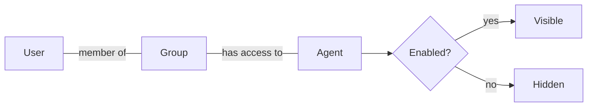

# Chapter 08 — Access, Budgets and Pricing

Three admin settings decide what a user can do: **groups** decide which agents they see, a **budget** decides how much they may spend per month, and **pricing** decides what a token costs. This chapter explains each and what the code does with it today.

## Group-Based Visibility

Access is closed by default. A user sees an agent only if all of these hold:

1. The agent is **Enabled**.
2. The agent has at least one **Access Group**.
3. The user belongs to at least one of those groups.

Superusers follow the same rules. A superuser who should chat with an agent must be in one of its groups.

| To do this | Go to |
|---|---|
| Create a group, add members and agents in one place | **Admin → Groups** |
| Put one user in groups | **Admin → Users → Edit → Groups** |
| Share one agent with groups | **Admin → Agents → Edit → Access Groups** |

Changes apply on the next request. Nothing is cached, though a user who has the welcome screen open sees the old agent list until they reload. Visibility is checked again on **every turn**: if a user loses access mid-conversation, the next message is rejected with *Agent ... not available*, and an unseen agent returns 404 as if it did not exist.

Old chats stay readable after access is removed, because chat history is tied to its owner and not to the agent's groups.

## Budgets

Each user has a **Monthly Budget** in US dollars. Set it on the user's edit page in **Admin → Users**; the users list does not show it. The model default is **$10.00**, which new users get whether they sign up, arrive through OIDC or are created by the bootstrap. It cannot be negative.

**Spend** is the sum of the recorded cost of that user's agent runs since 00:00 UTC on the 1st of the current month. It resets by itself when the UTC month changes. The sidebar meter and the dashboard use the same number.

### What happens at the limit

Budgets block requests. Before each turn the chat compares spend with the budget. When `spend >= budget` the turn is rejected with **HTTP 402** and the message *Budget exceeded. Please contact your administrator.* This applies to browser users, API keys and superusers alike. In an existing chat the rejected message and the error are saved, so they show after a reload.

The fix is to raise the budget on the user. It takes effect on the next message.

> **Watch out:** the check runs before the turn, not during it. A long multi-agent turn that starts under the limit finishes, and its cost is added afterwards. A user can therefore end a little above the budget.

> **Watch out:** a budget of `0` is not "unlimited". The check `0 >= 0` blocks every request, even though the meter and dashboard label it *no budget*. For a generous cap, enter a large number.

The chat sends no emails or alerts. The meter turns coloured at 50% and 85% for the user, and the dashboard's **User Budgets** table shows LOW, MEDIUM and HIGH ([Chapter 05](Chapter_05.md#dashboard)).

## Pricing

Pricing lives in **Admin → Model Pricing**. One row per model and provider (the pair must be unique).

| Field | Meaning |
|---|---|
| **Model Id** | Exactly as the agent reports it, for example `global.anthropic.claude-haiku-5-5` |
| **Provider** | The model's Python class path, exactly as the agent reports it: `strands.models.bedrock.BedrockModel`, `strands.models.openai.OpenAIModel`, `strands.models.anthropic.AnthropicModel`, ... |
| **Input / Output Token Price** | USD per 1 million tokens |
| **Cache Read / Cache Write Token Price** | USD per 1 million prompt-cache tokens. Default 0 |

Where do the values come from? Each time an agent finishes, it reports its model id, provider and token counts in the `agent_complete` event. If the event lacks the model, the chat takes it from the session manifest ([Chapter 06](Chapter_06.md#the-manifest)). The easiest way to see exact strings is the **Model Id** and **Provider** columns in **Token Usage**.

### Cost formula

Cache tokens are counted separately from input tokens, so each of the four counts gets its own rate. With $T$ the token count and $P$ the price per million tokens:

$$
\text{cost} = \frac{T_\text{input} P_\text{input} + T_\text{output} P_\text{output} + T_\text{cache read} P_\text{cache read} + T_\text{cache write} P_\text{cache write}}{1\,000\,000}
$$

The result is rounded to six decimals. A worked example, with made-up rates:

| Tokens | Count | Price (USD per 1M) | Cost (USD) |
|---|---:|---:|---:|
| Input | 10,000 | 1.00 | 0.010000 |
| Output | 2,000 | 5.00 | 0.010000 |
| Cache read | 50,000 | 0.10 | 0.005000 |
| Cache write | 5,000 | 1.25 | 0.006250 |
| **Total** | | | **0.031250** |

One **Token Usage** row is written per agent run, so a turn with three agents makes three rows. Rows with all four counts at zero are skipped.

### Rules to remember

- **Unknown model costs $0.** If no row matches the model id and provider (or the model is not reported), the tokens are saved with cost 0. That user's spend never grows, so their budget never trips. Add pricing before you launch an agent.
- **Cost is fixed when the run happens.** Changing a price does not touch old rows. To re-price, open **Token Usage**, select rows and run **Recalculate cost**. Rows with no pricing entry go to $0.
- Usage is saved on a best-effort basis. If the database write fails, the failure is logged and the chat continues, so that run is missing from spend.

## What Is Not Enforced

| Not enforced | Detail |
|---|---|
| Budget during a turn | Only checked at the start of each turn |
| Budget for unpriced models | Cost is $0, so nothing accumulates |
| Per-agent, per-group or per-model limits | Budgets exist per user only |
| Request rate or concurrency | No rate limit in the app. Use your load balancer or WAF |
| Attachment size and count | `CHAT_MEDIA_*` limits are published to the browser, which checks them. The chat server does not check them itself |
| Hiding old chats | Losing group access does not hide a user's past conversations |

## Next

[Chapter 09 — Configuration Reference](Chapter_09.md)
