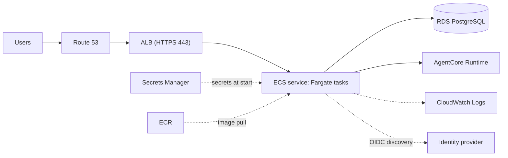

# Chapter 12 — Deploying on ECS Fargate

This chapter takes you from the image in [Chapter 11](Chapter_11.md) to a running service behind HTTPS. It lists what to create and which settings matter. It does not ship infrastructure code, so use whatever tool you already use (console, CLI, your own templates).



## Steps

1. **Push the image to ECR.** Create a repository, then tag and push `strands-compose-chat:0.8.0`. Build for the CPU architecture you choose in the task definition (on Apple silicon add `--platform linux/amd64` for X86_64).
2. **Create the database.** RDS for PostgreSQL in private subnets. Its security group accepts port 5432 from the task security group only. Create a database and a user for the app ([Chapter 10](Chapter_10.md)).
3. **Create secrets** in Secrets Manager (see [Environment and Secrets](#environment-and-secrets)).
4. **Create two IAM roles** (next section).
5. **Register the task definition** (settings below).
6. **Run the migration once** as a one-off task.
7. **Create the ALB and the service.**
8. **Verify** (end of chapter).

## IAM Roles

ECS uses two roles, and mixing them up is the most common first-day error.

| Role | Who uses it | Needs |
|------|-------------|-------|
| Task execution role | ECS itself, before your code starts | The AWS managed policy `AmazonECSTaskExecutionRolePolicy` (pull from ECR, write logs), plus `secretsmanager:GetSecretValue` on the secrets you reference |
| Task role | The app, through the standard AWS credential chain | `bedrock-agentcore:InvokeAgentRuntime`, and optionally `bedrock-agentcore:StopRuntimeSession`, on each runtime you register. Scope them to the runtime ARNs, not `*` |

The task role needs nothing else: the app does not call S3, Secrets Manager or any other AWS service. The policy statement, with the resource ARNs to allow, is in [Chapter 06](Chapter_06.md#permissions-on-aws).

## Task Definition

| Setting | Value | Why |
|---------|-------|-----|
| Launch type, network mode | Fargate, `awsvpc` | The only combination Fargate offers |
| CPU / memory | `256` / `512` to start | See [Sizing](#sizing) |
| Containers | One, named `app`, essential | The app is a single process tree |
| Port mapping | `8000` TCP | Gunicorn's default bind |
| `command` | `["gunicorn","-c","/app/gunicorn.conf.py","strands_compose_chat.app:app"]` | Replaces the image default so tasks do **not** migrate on start |
| `readonlyRootFilesystem` | `true` | Safe: only `/tmp` is written ([Chapter 11](Chapter_11.md#read-only-root-filesystem)) |
| Volume | One task volume named `tmp`, mounted at `/tmp` | On Fargate the volume is backed by task ephemeral storage. `tmpfs` is not available |
| `stopTimeout` | `60` to `120` (default 30, max 120) | Time for running streams to finish on deploy. Set `GUNICORN_GRACEFUL_TIMEOUT` to a little less |
| Health check | `curl` on `/health` | See the snippet |
| Logs | `awslogs` driver, one log group | Stdout and stderr go to CloudWatch |

```json
{
  "containerDefinitions": [{
    "name": "app",
    "image": "<account>.dkr.ecr.<region>.amazonaws.com/strands-compose-chat:0.8.0",
    "essential": true,
    "command": ["gunicorn", "-c", "/app/gunicorn.conf.py", "strands_compose_chat.app:app"],
    "portMappings": [{ "containerPort": 8000, "protocol": "tcp" }],
    "readonlyRootFilesystem": true,
    "mountPoints": [{ "sourceVolume": "tmp", "containerPath": "/tmp" }],
    "stopTimeout": 90,
    "environment": [
      { "name": "APP_ENV", "value": "prod" },
      { "name": "LOG_FORMAT", "value": "json" },
      { "name": "TRUSTED_HOSTS", "value": "[\"chat.example.com\"]" },
      { "name": "CORS_ALLOWED_ORIGINS", "value": "[\"https://chat.example.com\"]" },
      { "name": "GUNICORN_GRACEFUL_TIMEOUT", "value": "80" },
      { "name": "GUNICORN_KEEPALIVE", "value": "65" }
    ],
    "secrets": [
      { "name": "SESSION_SECRET_KEY", "valueFrom": "arn:aws:secretsmanager:<region>:<account>:secret:chat/session-key-AbCdEf" },
      { "name": "DATABASE_URL", "valueFrom": "arn:aws:secretsmanager:<region>:<account>:secret:chat/database-url-AbCdEf" }
    ],
    "healthCheck": {
      "command": ["CMD-SHELL", "curl --fail --silent http://localhost:8000/health || exit 1"],
      "interval": 30, "timeout": 5, "retries": 3, "startPeriod": 60
    },
    "logConfiguration": {
      "logDriver": "awslogs",
      "options": {
        "awslogs-group": "/ecs/strands-compose-chat",
        "awslogs-region": "<region>",
        "awslogs-stream-prefix": "app"
      }
    }
  }],
  "volumes": [{ "name": "tmp" }]
}
```

The image contains `curl`, so the `CMD-SHELL` check works without changes.

## Environment and Secrets

Put anything with a password or key into Secrets Manager and reference it under `secrets`. Everything else can be a plain `environment` entry. All names are explained in [Chapter 09](Chapter_09.md).

| Kind | Variables |
|------|-----------|
| Secrets | `SESSION_SECRET_KEY`, `DATABASE_URL` (it holds the DB password), `ADMIN_BOOTSTRAP_PASSWORD`, every `OIDC_<ID>_CLIENT_SECRET` |
| Plain | `APP_ENV=prod`, `LOG_FORMAT=json`, `TRUSTED_HOSTS`, `CORS_ALLOWED_ORIGINS`, `ADMIN_BOOTSTRAP_USERNAME`, `OIDC_PROVIDERS`, `OIDC_REDIRECT_URI`, other `OIDC_<ID>_*`, `URL_PREFIX`, `WEB_CONCURRENCY`, `GUNICORN_*` |

To read one key from a JSON secret, end the `valueFrom` ARN with `:KEY::`. Every task must get the **same** `SESSION_SECRET_KEY`, otherwise a user signed in on one task is a stranger on the next.

Set `TRUSTED_HOSTS` to the exact host name users type. `OIDC_REDIRECT_URI` must be the public `https://` callback and must match what you registered at the identity provider ([Chapter 07](Chapter_07.md)).

## Run the Migration

Run the same task definition once with the command replaced. Wait for it to stop before you update the service.

```bash
aws ecs run-task --cluster chat --launch-type FARGATE --task-definition strands-compose-chat --network-configuration "awsvpcConfiguration={subnets=[subnet-aaa],securityGroups=[sg-bbb],assignPublicIp=DISABLED}" --overrides "containerOverrides=[{name=app,command=[strands-compose-chat,migrate]}]"
```

Check that the container exited with code `0` (`aws ecs describe-tasks`, field `containers[].exitCode`) and read its log stream. Do this on the first deploy and on every upgrade ([Chapter 13](Chapter_13.md#upgrades-and-rollback)).

## Load Balancer and Service

| Setting | Value | Notes |
|---------|-------|-------|
| Listeners | 443 HTTPS with an ACM certificate; 80 redirects to 443 | The session cookie is HTTPS-only in prod |
| Target group | Type `ip`, protocol HTTP, port `8000` | Required for `awsvpc` |
| Health check path | `/health` | Cheap and independent of the database, and exempt from `TRUSTED_HOSTS`. `/ready` also checks the DB, but then a database blip pulls every task out of rotation |
| Health check timing | Interval 30 s, timeout 5 s | The AWS defaults. Healthy and unhealthy thresholds 2 to 3 |
| Idle timeout | Default 60 s is enough | The app sends an SSE `: ping` every 20 s while the agent is silent, so an open stream never idles for 60 s |
| Stickiness | Off | The session is a signed cookie, state is in the database, and the agent client cache holds only connections |
| Deregistration delay | Default | Lower it to speed up deploys, accepting that open streams get cut sooner |
| Service | Desired count 2 or more, health check grace period 60 s, minimum healthy 100 %, maximum 200 % | Two tasks keep chat available during a deploy |
| Security groups | ALB to tasks on 8000; tasks to RDS on 5432 | Tasks also need outbound access to AgentCore, ECR, Secrets Manager, CloudWatch Logs and your identity provider (NAT gateway or VPC endpoints) |

Also set `GUNICORN_KEEPALIVE=65` so Gunicorn keeps idle connections longer than the ALB does ([Chapter 11](Chapter_11.md#gunicorn-settings)).

## Sizing

Estimates from the maintainer's experience, not benchmarks on Fargate.

| Task size | Workers | Active users per task | Notes |
|-----------|---------|-----------------------|-------|
| 0.25 vCPU / 512 MB | 1 (`WEB_CONCURRENCY=1`) | About 50 | CPU is the limit |

In real use about 25 users per task works well, so 100 to 125 users run on 4 to 5 tasks. Start with 2 tasks and add by CPU. A target-tracking scaling policy on average CPU (about 60 %) is a sensible default, but scale-in stops tasks and cuts their streams, so keep the minimum high enough that scale-in is rare.

> **Tips & Tricks**
> Each password login briefly needs about 64 MiB (`ARGON2_MEMORY_KIB`). Many users signing in at the same minute on a 512 MB task can run it out of memory. Use SSO, move to 1 GB, or stagger the start of the day. Lowering the Argon2 cost weakens your stored hashes.

## Verify

1. The target group shows all tasks **healthy**.
2. `curl -i https://chat.example.com/health` returns `200 {"status":"ok"}`, and `/ready` returns `{"status":"ready"}`.
3. The sign-in page loads, and the bootstrap admin can sign in.
4. In `/admin`, register an agent and a group ([Chapter 06](Chapter_06.md)), then send a message and watch it stream.
5. CloudWatch shows JSON lines, with `Bootstrap superuser created` on the first start only.

## Go-Live Checklist

- [ ] `APP_ENV=prod`, `LOG_FORMAT=json`
- [ ] `TRUSTED_HOSTS` and `CORS_ALLOWED_ORIGINS` name your real domain
- [ ] `SESSION_SECRET_KEY` is a long random value, identical on all tasks, stored as a secret
- [ ] Migration task finished with exit code 0
- [ ] Bootstrap admin signed in once and its password changed in the admin panel ([Chapter 13](Chapter_13.md#bootstrap-admin))
- [ ] `GUNICORN_MAX_REQUESTS` and `GUNICORN_KEEPALIVE` set as in Chapter 11
- [ ] RDS backups on, deletion protection on
- [ ] Task role limited to the runtime ARNs
- [ ] Alarm on unhealthy hosts and on task memory

## Next

[Chapter 13 — Operations](Chapter_13.md)
