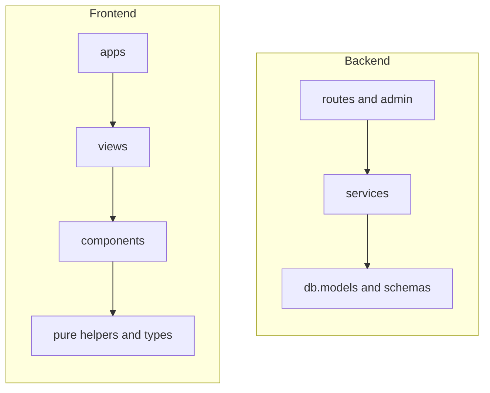

# Chapter 16 — Developer Guide

This chapter is a map for people changing the code. It tells you where things live, how to run both halves together, and which commands to use. For conventions in depth, read the skill files linked at the end.

## Code Map

### Backend: `src/strands_compose_chat/`

| Path | Role |
|------|------|
| `app.py` | Composition root. `create_app()` wires handlers, middleware, routers, admin and frontend, and runs startup in `lifespan` |
| `cli.py` | The `strands-compose-chat` / `scc` command: `migrate` and `serve` |
| `config.py` | One `Settings` class (pydantic-settings), production checks, cached `get_settings()` |
| `deps.py` | Dependency providers: `DbSession`, `AppSettings`, `OidcRegistry`, `AgentClients` |
| `errors.py` | RFC 9457 Problem Details and the exception handlers |
| `agents/` | Agent visibility, client cache, the `/invocations` route, SSE streaming and saving |
| `auth/` | Local login, OIDC, API keys, current-user dependencies, just-in-time provisioning |
| `sessions/` | Chat session and message endpoints and queries |
| `media/` | Attachment capabilities and content-block building |
| `analytics/` | Usage and cost aggregation, split into admin and per-user routers |
| `admin/` | sqladmin views, one file per model, plus the dashboard and transcript pages |
| `db/` | Engine, ORM models (one per file), Alembic migrations |
| `schemas/` | Pydantic request and response models |
| `middleware/` | Security headers, trusted host with health exemption |
| `frontend.py`, `templates/`, `static/` | Page shells and the compiled UI. `static/` is filled by a UI build |

Features follow one shape: `routes.py` is thin HTTP, `service.py` holds async functions that take the database session first and never import FastAPI.

### Frontend: `ui/`

| Path | Role |
|------|------|
| `index.html`, `login.html`, `admin/dashboard.html` | The three entries: chat, sign-in, admin dashboard |
| `src/apps/` | One folder per entry: mount point and provider stack |
| `src/views/` | Screens (`chat/`, `workflow/`, `auth/`, `profile/`, `admin/`) |
| `src/components/` | Reusable primitives and the `charts/` package |
| `src/store/` | Zustand store. `store/streaming/` turns stream events into the Workflow panel |
| `src/services/` | `api.ts`, `adminApi.ts`, pure helpers, and `demoApi.ts` for the demo build |
| `src/contexts/`, `src/hooks/`, `src/types/` | Providers, shared hooks, shared types |
| `src/index.css` | Global styles and all theme tokens |

### Dependency Direction

Imports flow one way. Inner layers never import outward.



`config`, `errors`, `logging` and `db.base` are foundation modules that import nothing application-specific. A service that needs FastAPI, or a primitive that imports a view, is a sign the code belongs one layer over.

## Run the Backend and the UI Together

Two terminals, one `.env` at the repository root (see [Chapter 03](Chapter_03.md)).

```bash
# terminal 1: API on http://127.0.0.1:8000
uv run scc migrate
uv run scc serve

# terminal 2: Vite dev server with hot reload on http://localhost:5173
npm --prefix ui ci
npm --prefix ui run dev
```

Open the Vite address. Vite serves the HTML entries itself, including `/admin/dashboard`, and proxies `/auth/`, `/api/` and the rest of `/admin` to port 8000. The default `CORS_ALLOWED_ORIGINS` already allows `http://localhost:5173`. Vite reads `URL_PREFIX` from the root `.env`, so the proxy follows it.

Without a built `static/` folder, the backend logs a warning and runs in API-only mode. That is expected while you work through Vite.

## `just` Recipes

Run them as `uv run just <recipe>`. `uv run just` lists them all.

| Recipe | What it does |
|--------|--------------|
| `install` | `uv sync` with all groups and extras, plus git hooks |
| `check` | Fix import order and format, then `ruff` lint, `ty` type check, `bandit` security scan |
| `verify` | The same checks as `check`, but changes no file. CI runs it |
| `format` | Import sort and `ruff format` |
| `check-ui`, `format-ui` | UI: check or fix format, import order and lint with Biome |
| `check-hooks` | Run every git hook on every file |
| `test` | Fast tier: everything except `@postgres` tests, with coverage (fails under 65% by default) |
| `update-snapshot` | Regenerate the OpenAPI snapshot after an intended API change |
| `test-postgres` | Postgres tier. Needs `DATABASE_URL` pointing at a live Postgres. `db_host` defaults to `localhost` |
| `migrate` | `alembic upgrade head` |
| `revision "msg"` | Autogenerate a migration. A second argument sets the revision id |
| `build-ui` | `npm ci` and a UI build into `src/strands_compose_chat/static` |
| `clean` | Remove caches and build folders |
| `commit-files`, `commit-bump` | Commitizen helpers |
| `release-dry`, `release` | Preview or perform a version bump and tag |

## Build the UI into the Package

```bash
uv run just build-ui
```

This runs `npm run build:backend`, which builds into `src/strands_compose_chat/static`. The build deletes the generated HTML on purpose. The pages are rendered from the Jinja shells in `templates/`, which point at fixed asset names such as `js/index.js`. A new entry therefore needs a shell as well.

## Theme Tokens

All colours live in `ui/src/index.css` as CSS variables: brand tokens `--aws-*` and semantic tokens `--sc-*` (`--sc-bg-*`, `--sc-text-*`, `--sc-border-*`). Dark mode redefines the `--sc-*` set under `[data-theme="dark"]`. Add a token for both themes rather than hardcoding a colour. Chart code reads tokens through the `cssVar()` helper.

## Tests

| Where | Run | Notes |
|-------|-----|-------|
| Backend, `tests/` | `uv run just test` | `pytest` with `asyncio_mode = auto`. Sockets are disabled except loopback. Folders: `agents`, `analytics`, `auth`, `contract`, `db`, `media`, `sessions`, `unit`, with fakes in `fakes/` |
| Contract | inside `test`; refresh with `uv run just update-snapshot` | Compares the OpenAPI document with `openapi.snapshot.json`. Refresh it when you change an endpoint on purpose |
| Postgres tier | `uv run just test-postgres` | Dialect-sensitive tests and the migration guard |
| UI unit | `npm --prefix ui test` | Vitest, pure logic only, next to the code |
| UI end-to-end | `npm --prefix ui run test:e2e` | Playwright in Chromium against a fake backend. See [`ui/README.md`](../ui/README.md) |

## Add a Migration

1. Change the model in `db/models/` and keep the barrel `db/models/__init__.py` in sync.
2. Run `uv run just revision "add foo to bar"`, optionally with the next id (`... 0004`) to keep the numbered file names.
3. Read the generated script in `db/migrations/versions/` and fix anything autogenerate got wrong.
4. Run `uv run just migrate` against SQLite, and `uv run just test-postgres` for dialect differences.

Never edit the database by hand. Operators apply the result with `scc migrate` ([Chapter 10](Chapter_10.md)).

## Demo Build

```bash
npm --prefix ui run build:demo
```

Vite's `demo` mode swaps `services/api.ts` for `services/demoApi.ts`, which replays the fixtures in `services/demo-fixtures/`. The result is a static site with a relative base path, the chat entry only, and no backend. The [live demo](https://strands-compose.github.io/chat/) is this build, deployed by the `pages.yml` workflow. Update the fixtures when the stream events change ([Chapter 14](Chapter_14.md)).

## Go Deeper

| Topic | File |
|-------|------|
| Backend conventions and layering | [`backend-development/SKILL.md`](../.kiro/skills/backend-development/SKILL.md), [`project-map.md`](../.kiro/skills/backend-development/references/project-map.md) |
| Backend test doctrine and templates | [`backend-testing/SKILL.md`](../.kiro/skills/backend-testing/SKILL.md), [`test-patterns.md`](../.kiro/skills/backend-testing/references/test-patterns.md) |
| Frontend conventions and layering | [`frontend-development/SKILL.md`](../.kiro/skills/frontend-development/SKILL.md), [`project-map.md`](../.kiro/skills/frontend-development/references/project-map.md) |
| Project rules | [`AGENTS.md`](../AGENTS.md), [`CONTRIBUTING.md`](../CONTRIBUTING.md) |

## Next

[Quick Recipes](Quick_Recipes.md)
